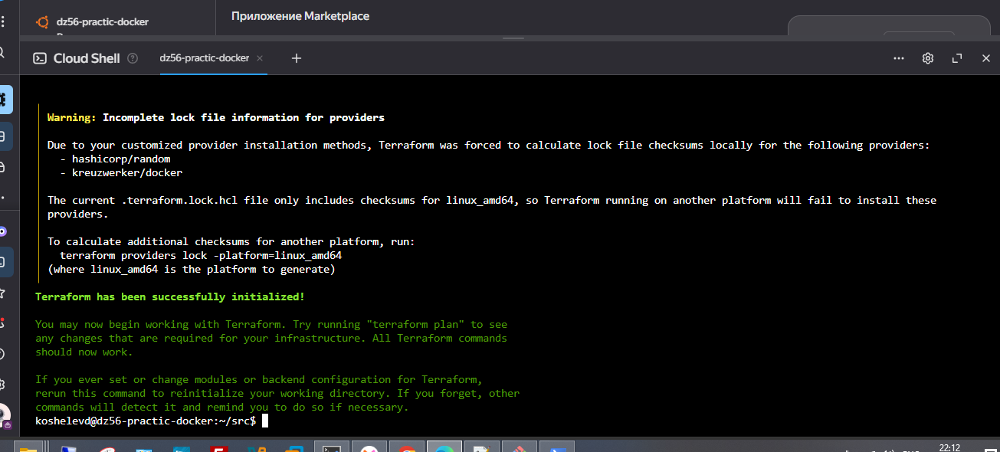
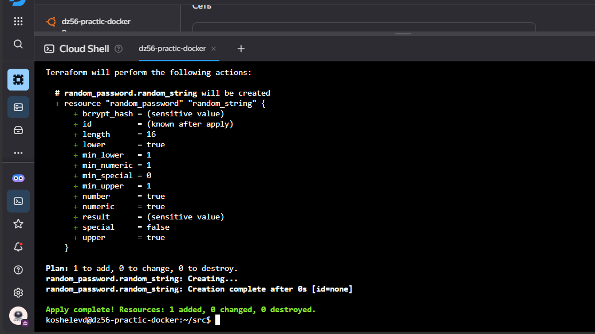
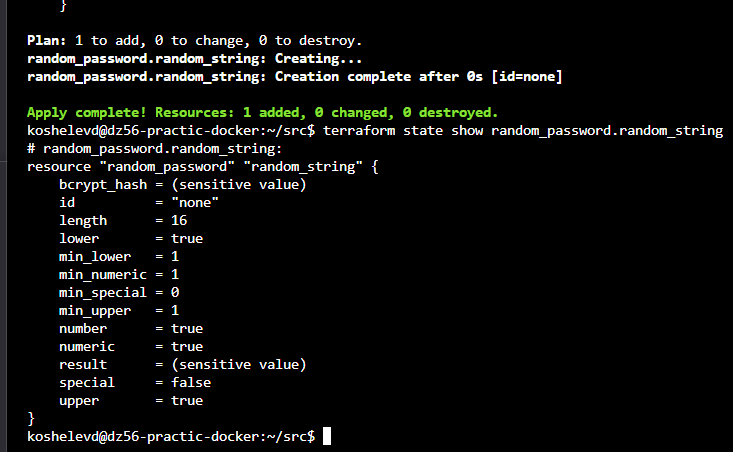
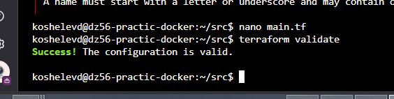
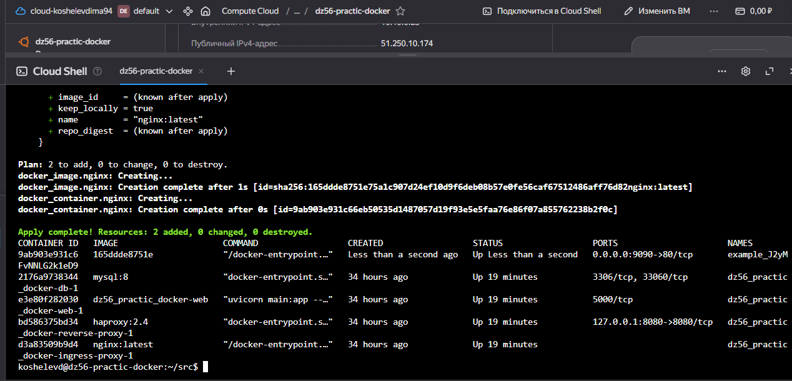
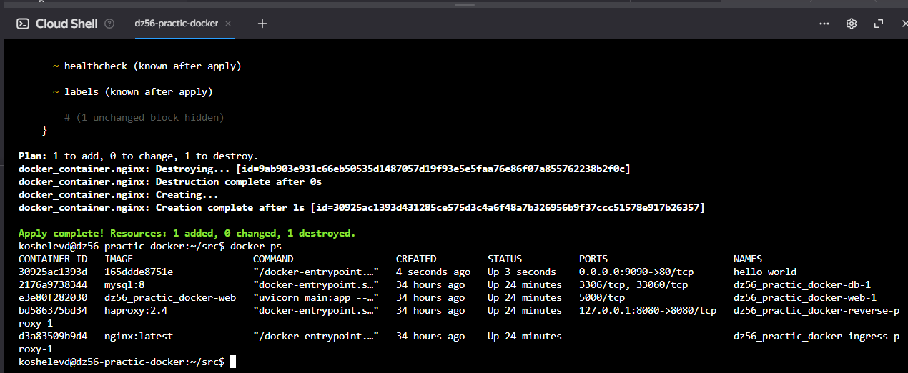
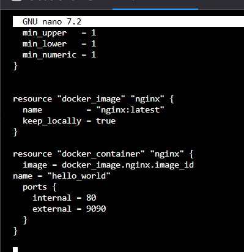
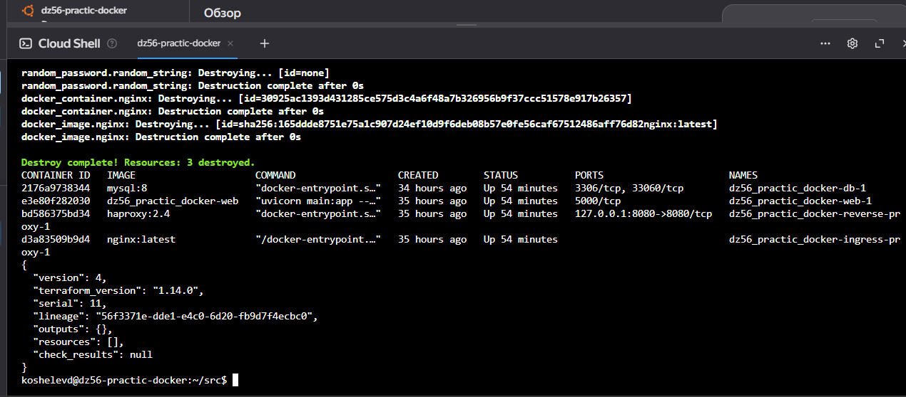

# Домашнее задание к занятию "Введение в Terraform" - Кошелев Дмитрий Владимирович


##Задание 1

Перейдите в каталог src. Скачайте все необходимые зависимости, использованные в проекте.
Изучите файл .gitignore. В каком terraform-файле, согласно этому .gitignore, допустимо сохранить личную, секретную информацию?(логины,пароли,ключи,токены итд)
Выполните код проекта. Найдите в state-файле секретное содержимое созданного ресурса random_password, пришлите в качестве ответа конкретный ключ и его значение.

```
result      = (sensitive value)
koshelevd@dz56-practic-docker:~/src$ cat terraform.tfstate | grep -B1 -A1 '"result"'
            "override_special": null,
            "result": "J2yMFvNNLG2k1eD9",
            "special": false,
--
                "type": "get_attr",
                "value": "result"
              }
koshelevd@dz56-practic-docker:~/src$ 
```

Раскомментируйте блок кода, примерно расположенный на строчках 29–42 файла main.tf. Выполните команду terraform validate. Объясните, в чём заключаются намеренно допущенные ошибки. Исправьте их.
Выполните код. В качестве ответа приложите: исправленный фрагмент кода и вывод команды docker ps.
Замените имя docker-контейнера в блоке кода на hello_world. Не перепутайте имя контейнера и имя образа. Мы всё ещё продолжаем использовать name = "nginx:latest". Выполните команду terraform apply -auto-approve.

 
Объясните своими словами, в чём может быть опасность применения ключа -auto-approve. Догадайтесь или нагуглите зачем может пригодиться данный ключ? В качестве ответа дополнительно приложите вывод команды docker ps.
Уничтожьте созданные ресурсы с помощью terraform. Убедитесь, что все ресурсы удалены. Приложите содержимое файла terraform.tfstate.

```
Без этого ключа команда terraform apply строит план, а затем спрашивает: «Do you want to perform these actions? … Only 'yes' will be accepted». 
И становится видно, что именно будет создано/изменено/удалено, и можно отказаться.
Флаг -auto-approve убирает этот шаг: Terraform сразу применяет план. Риски: 
Нет проверки. Если в конфигурации есть ошибка (конфликт портов, уже занятое имя контейнера, лишний ресурс), действие выполнится «вслепую».
Разрушительные операции. Это касается и terraform destroy: вы не увидите список удаляемых ресурсов и не сможете остановиться. Отката нет.
Несогласованность. Если параллельно кто-то (или другой скрипт) изменил инфраструктуру, может возникнуть «дрейф», а частичный сбой во время apply способен привести к противоречивому состоянию (state ≠ реальная инфраструктура).
```

Объясните, почему при этом не был удалён docker-образ nginx:latest. Ответ ОБЯЗАТЕЛЬНО НАЙДИТЕ В ПРЕДОСТАВЛЕННОМ КОДЕ, а затем ОБЯЗАТЕЛЬНО ПОДКРЕПИТЕ строчкой из документации terraform провайдера docker. (ищите в классификаторе resource docker_image )

```
resource "docker_image" "nginx" {
  name        = "nginx:latest"
  keep_locally = true
}

Ключевой атрибут — keep_locally = true
```
Документация провайдера (kreuzwerker/docker, ресурс docker_image)
Файл docs/resources/image.md:

```
keep_locally (Boolean) — If true, then the Docker image won't be deleted on destroy operation. If this is false, it will delete the image from the docker local storage on destroy operation.
```

Вопросы:
В каком файле по .gitignore допустимо хранить секреты?
Файл personal.auto.tfvars.
```
Это личный файл переменных: суффикс .auto.tfvars означает, что Terraform загружает его автоматически (не нужно указывать -var-file). Главное условие — файл исключён через .gitignore, поэтому он не попадает в репозиторий.
```

В чём заключались намеренно допущенные ошибки из terraform validate
```
Были добавлены намеренные ошибки: отсутствующее имя блока docker_image, имя ресурса docker_container, начинающееся с цифры (1nginx), и ссылка на несуществующую сущность (random_string_FAKE.resulT). После исправлений terraform validate вернул «No errors».
```

## Решение
```Команда terraform destroy убрала управление ресурсом из состояния («3 destroyed», в том числе docker_image.nginx), но сам Docker-образ nginx:latest остался в локальном хранилище: атрибут keep_locally = true специально отключает удаление образа при операции destroy.

(Важное различие: ресурс уничтожен ≠ образ удалён.)
```

;
;
;
;
;
;
;
;